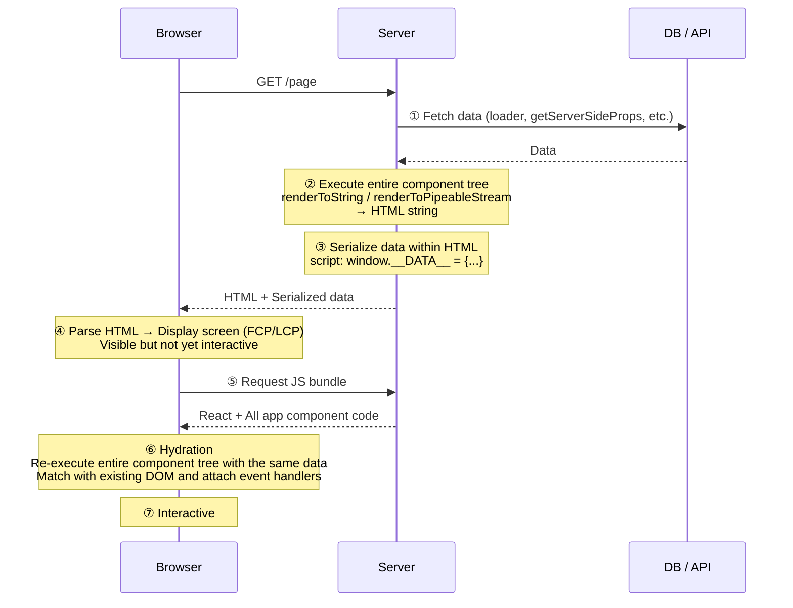
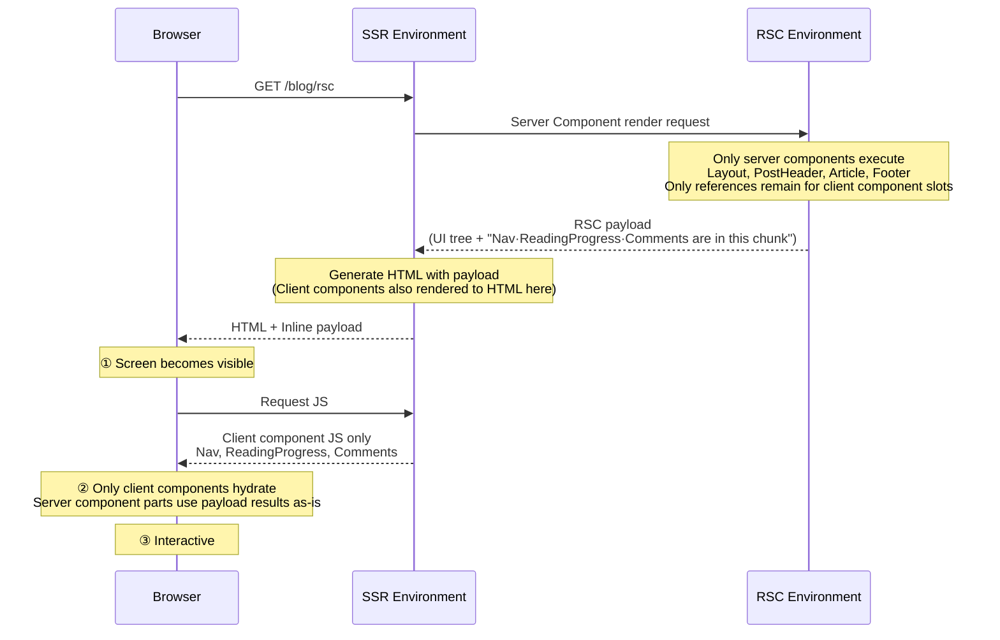
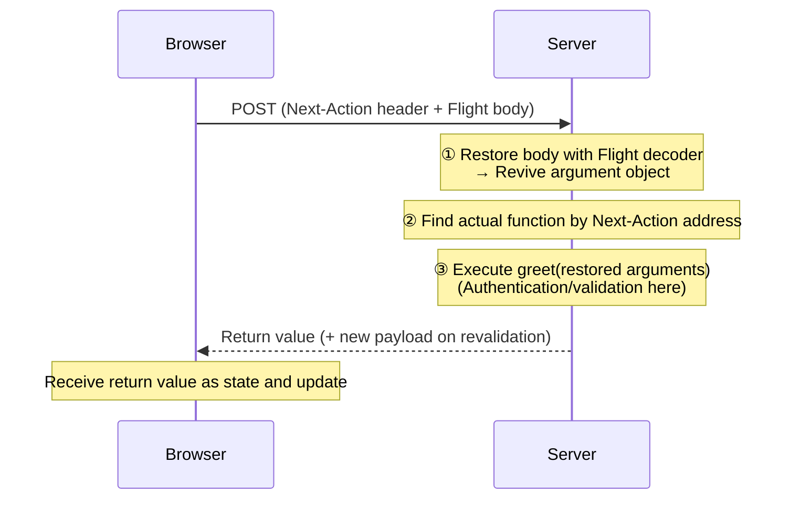

## 0. Background of Exploration

Both at my company and on this blog, we use React Router v7. Because of this, I only knew React Server Components (RSC) as "that thing in Next.js App Router."

However, there were continuous discussions about slow app loading. When performance comes up, the phrase "using Server Components reduces bundle size" naturally follows. But is that really true? Is the slowness we're experiencing the kind that RSC can alleviate?

This post started from that question. It systematically dissects what problems SSR left behind and how RSC solved them differently, what exactly the RSC payload sent by the server is, and how Server Functions operate in the opposite direction. When examples are needed, I'll borrow from this blog's post pages.

## 1. What SSR Solved and What it Left Behind

We often hear explanations like "RSC improves SEO and speeds up initial loading." However, these are things we already gain with SSR. To understand why RSC emerged, we need to look at how far SSR went in solving problems.

### How SSR Works

SSR (Server-Side Rendering) is a method where **React components are executed on the server to first generate and send HTML, and then the same components are re-executed in the browser to create a live app.** Next.js Pages Router, Remix, and React Router Framework Mode all follow this structure. A single page request typically flows like this:



There are three key points in the diagram:

-   **①** Components are rendered synchronously, so necessary data is gathered beforehand. This is why frameworks have a **data layer outside the component**, such as `loader` or `getServerSideProps`.
-   **③** When the browser hydrates, it must render with the exact same data as the server for the results to match. Therefore, the data fetched in ① is embedded as JSON within the HTML.
-   **⑤~⑥** To hydrate, the **code for all components** that make up the page is required. This includes all libraries imported by those components. `hydrateRoot` re-executes the entire tree with this code to attach event handlers to the existing DOM, blocking the main thread during this process.

In code, it looks like this:

```typescript
// 서버
const data = await loader(request);
const html = renderToString(<App data={data} />);
res.send(`
  <div id="root">${html}</div>
  <script>window.__DATA__ = ${JSON.stringify(data)}</script>
  <script src="/bundle.js"></script>
`);

// 브라우저 (bundle.js)
hydrateRoot(document.getElementById("root"), <App data={window.__DATA__} />);
```

### SSR's HTML is Not a Finished Product

Here's an important perspective: In the days of JSP or PHP, server rendering produced HTML that was itself a finished product. The browser would receive and display it, with separate scripts handling interaction.

Modern SSR is different. **The core of the app is still the client's React app, and the HTML sent by the server is a snapshot that pre-renders its first screen.** The app only becomes interactive after the JS arrives and the same component tree takes over (hydrates) that HTML.

Therefore, modern SSR is less a "server-rendered app" and more **an optimization for the initial screen of a CSR app.**

### Costs Left by SSR

The limitations of this structure are clear:

-   **Bundle size does not decrease.** Even static content like post bodies, product descriptions, and footers, which never change after being rendered once, are sent as JS and hydrated. Code that only needs its result, like Markdown parsers or date formatting libraries, also goes along.
-   **Data is sent twice.** Once within the HTML, and again as serialized data for hydration.
-   **Data requirements are hoisted to the route level.** Data needed by deeply nested components must be gathered beforehand in `loader` or `getServerSideProps` and passed down as props. This separates components from the data they use.
-   **The client re-executes what the server has already rendered.** Even parts whose results will not change.

Ultimately, SSR was merely **"an optimization to display the first screen quickly,"** but it failed to reduce the costs borne by the client itself.

## 2. RSC Changed the Question

At this point, the React team changed the question. Instead of "Should the first screen be rendered on the server?", it became **"Does this component even need to go to the client?"**

The answer, unveiled in December 2020 under the name "Zero-Bundle-Size React Server Components," is as follows:

-   Components without interaction **execute only on the server** and send only their results. Their code and dependencies are not included in the bundle and are not re-executed on the client.
-   Components **fetch data directly.** There's no need to centralize data requirements at the route level.
-   The result is delivered not as HTML, but as an **RSC payload**, which is merged into the live React tree. This allows the client to receive server results while maintaining client state, even when navigating between pages.

### Not in Competition with SSR

This often leads to a common misunderstanding: Server Components do not replace SSR. They answer different questions.

|                   | SSR                               | Server Components                 |
| :---------------- | :-------------------------------- | :-------------------------------- |
| Question it answers | Where to create the initial HTML? | Where to execute this component?  |
| Application timing | First request                     | First request + subsequent navigation |
| Output            | HTML                              | RSC payload                       |
| Component code    | All goes to client                | Server components do not go       |
| Hydration         | Entire tree                       | Client components only            |

In fact, Next.js App Router uses both together. Server Components create the payload, and SSR uses that payload to generate the initial HTML. Client Components are also SSR'd on the first request.

### RSC as Seen Through a Blog Post Page

I've assumed this blog's post page is composed of the following components:

| Component                          | Function                                            | Interaction |
| :--------------------------------- | :-------------------------------------------------- | :---------- |
| `Layout`, `PostHeader`, `Footer` | Static markup like title, date, tags                | None        |
| `Article`                          | Converts Markdown to HTML (unified, remark, rehype, highlighter) | None        |
| `Nav`                              | Menu, language switching                            | Yes         |
| `ReadingProgress`                  | Updates progress bar based on scroll                | Yes         |
| `Comments`                         | Comment widget                                      | Yes         |



Server Components execute only on the server, and the browser receives only their **results (RSC payload)**. Theoretically, this means Markdown libraries, which would have been included in the bundle with SSR, do not go to the client, reducing bundle size. Also, only `Nav`, `ReadingProgress`, and `Comments` need hydration, which should make the time-to-interactive faster. However, this assumes Markdown conversion was originally part of the client bundle. If it was already running only on the server, there's nothing to reduce. We'll revisit this point in the conclusion.

In short, **SSR optimized "when to show," while RSC optimized "what to send."**

## 3. CSR / SSR / RSC — What's Different?

I compared the three approaches on the same timeline.


-   **CSR**: Receives an empty HTML, downloads and executes JS, and only then does the browser request the API. This adds another round trip, making content appear latest.
-   **SSR**: Fetches data on the server and generates HTML, so content appears quickly. However, it needs to download the entire app JS and hydrate the entire tree before it becomes interactive. This "visible but not interactive" period is the cost of SSR.
-   **RSC**: Data fetching location and response time are the same as SSR. The difference lies afterward. Server Components are excluded from the bundle and hydration, shortening that period.

| Metric            | CSR                       | SSR                           | RSC                           |
| :---------------- | :------------------------ | :---------------------------- | :---------------------------- |
| TTFB              | Fast (empty HTML)         | Slows down by server work     | Same as SSR or slightly slower |
| FCP · LCP         | Slow                      | Fast                          | Same as SSR                   |
| TBT · INP during loading | As much as bundle execution | Bundle + full hydration       | As much as client components  |

Summarized by what goes over the network:

|           | What goes over the network                          |
| :-------- | :-------------------------------------------------- |
| CSR       | Empty HTML + entire app JS + JSON                   |
| SSR       | HTML + entire app JS + serialized data              |
| SSR + RSC | HTML + RSC payload + client component JS only       |

In summary, **SSR accelerates "visible speed" (FCP, LCP), and RSC adds "usable speed" (TBT, INP) to that.** However, the effect only occurs proportionally to the amount shifted to Server Components, and response size can be larger or smaller than SSR depending on the data format.

## 4. What is an RSC payload?

When explaining RSC, the RSC payload is constantly mentioned. Simply put, it's data that represents the entire UI tree. So why does RSC need a UI Tree generated on the server?

### SSR Hydration

Hydration is the process of re-executing React code directly on top of the HTML generated by the server.

In other words, it's a recursive process that **hydrates element objects one by one, starting from the Root.**

```javascript
hydrateRoot(root, <App data={window.__DATA__} />)
//                 ↑ { type: App, props: {...} } — 함수
```

Executing `App` leads to `ProductPage`, which is also a function, so it's executed again, and so on, **recursively traversing the function branches all the way down.** This is why the code for all components making up the page must be in the bundle.

However, the goal of Server Components is not to send code to the client. Even if we only want to hydrate client components, React needs to know where they are in the tree and what their siblings are to match them with the DOM.

**Therefore, the server sends the entire tree's structure as data. That is the RSC payload.**

```javascript
0:["$","div",null,{"children":[["$","h1",null,{"children":"Async Component"}],["$","$1",null,{"fallback":["$","p",null,{"children":"Loading..."}],"children":"$L2"}]]}]
```

### Why was a new format (Flight) needed?

In short, existing data formats couldn't accommodate the React tree structure.

```javascript
//jsx
<main>
  <h1>RSC 탐구기</h1>
  <p>본문</p>
</main>

//컴파일된 형태
{
  type: "main",
  props: {
    children: [
      { type: "h1", props: { children: "RSC 탐구기" } },
      { type: "p",  props: { children: "본문" } },
    ],
  },
}
```

Looking at the example above, the UI tree itself is a data tree that can be expressed in JSON, but sending React's Tree structure over a network request presents two problems:

**1. A function can appear in the `type` field.**

```javascript
<Counter initial={0} />
// → { type: Counter, props: { initial: 0 } }
//          ↑ Not a string, but the function itself
```

HTML tags like `"h1"` are strings, so they're fine. But components are functions, and functions cannot be serialized to JSON.

So, RSC sends **only "which export of which module" instead of the function itself.** In the actual payload, it looks like this:

```plain text
1:I["/src/counter.tsx",["/assets/counter.js"],"Counter"]
0:["$","$L1",null,{"initial":0}]
```

**2. Asynchronous components are mixed in.**

Server Components can be `async`. If fetching comments takes 3 seconds, that tree will only be complete after 3 seconds. Since JSON must be a complete string to be `JSON.parse`d, even if everything else is ready, you'd have to wait 3 seconds.

In summary, to send a UI tree, two things need to be added to JSON:

| What's needed                 | JSON                      | RSC payload               |
| :---------------------------- | :------------------------ | :------------------------ |
| Nested UI structure           | Yes                       | Yes                       |
| Pointing to client components | No (function serialization impossible) | Module reference (`I` row) |
| Sending unfinished parts first | No (must be complete to parse) | Placeholder + later row   |

The solution to the first problem is the module reference we just saw, and the solution to the second problem will be discussed later.

> This format's official name is **Flight**. It's the name used internally in the React repo and is implemented in the `react-server` and `react-client` packages. It's an implementation detail, not a public specification, so it may change between versions.
>
> The "RSC payload" used in Next.js documentation refers to the serialized output in this format. At the HTTP level, it's sent with `Content-Type: text/x-component`.

### Streaming

Streaming is an indispensable concept when explaining RSC.

Streaming is a method that allows the UI to be progressively rendered from the server, expressed as `chunked` in the HTTP response `transfer-Encoding`.

While streaming techniques ultimately involve progressively fetching and completing data, we need to think a bit more deeply about how to stream a UI tree.

Dan Abramov's article [Progressive JSON](https://overreacted.io/progressive-json/) kindly explains how objects can be streamed based on the JSON format.

> Dan Abramov's "Progressive JSON" is not a separate format but **a name given to explain the same concept.** The article starts with ordinary JSON, progressively derives Flight's serialization strategy, and concludes by stating that this is essentially how RSC works. However, the article's scope covers only the serialization strategy; the module references seen above are added on top of that.

Without streaming, if fetching comments takes 3 seconds, even the already prepared header and footer would have to wait 3 seconds.

So, if we apply streaming and simply send sequentially from top to bottom, the completeness of the JSON becomes an issue (the same applies if streaming HTML).

```plain text
// t=0s, 서버가 보낼 수 있는 만큼 보냈다
{"header":"Welcome to my blog","post":{"content":"This is my article","comments":
```

The bracket isn't closed, and putting it into `JSON.parse` would result in a `SyntaxError`. Each fragment is not a complete value in itself, so the receiver cannot do anything. It's no different from waiting for everything to arrive.

Even if a custom parser were used, a more fundamental problem remains. When the `comments` field is empty, there's no way to distinguish whether it's "a value that was never there" or "a value that hasn't arrived yet." The format lacks a way to express "not yet."

Therefore, the unit of splitting is changed. Instead of cutting a monolithic JSON in the middle, it's divided into individually complete fragments (rows) from the start, and unknown parts are explicitly marked with placeholders.

```javascript
// 첫 번째 행 (루트)
{ header: "$1", post: "$2", footer: "$3" }
/* $1 */ "Welcome to my blog"
/* $3 */ "Hope you like it"
/* $2 */ { content: "$4", comments: "$5" }
/* $4 */ "This is my article"
/* $5 */ ["$6", "$7"]
/* $6 */ "First comment"
/* $7 */ "Second comment"
```

Sending it this way changes three things:

-   Each row is a complete JSON in itself. There are no half-arrived rows. When a row arrives, it can be `JSON.parse`d immediately.
-   **Unknown parts are explicitly "not yet arrived."** `"$2"` is a promise that it will arrive later, so there's no confusion with missing values.
-   Rows arrive in any order as they are ready. In the example above, `$3` (footer) arrived before `$2` (post). Slow comments do not block the footer.

One thing here can be confusing. `/* $1 */` looks like a separate chunk, making it seem like **another request needs to be sent or the server re-executes** to receive later rows.

Neither is true. **It's one request, one execution, and one response.** The placeholder marks a part that hasn't finished in that single execution, and later rows are the results of the same execution continuing. The server keeps the response open and writes to the same stream. The response ends when all remaining placeholders are filled.

When the receiver encounters `"$2"`, it inserts a **pending Promise** in that spot, and when the `$2` row arrives later, it resolves it.

```javascript
// 첫 행만 받은 시점
{
  header: "Welcome to my blog",
  post: Promise<pending>,
  footer: "Hope you like it",
}

// $2 행까지 받은 시점
{
  header: "Welcome to my blog",
  post: { content: "This is my article", comments: Promise<pending> },
  footer: "Hope you like it",
}
```

With this method, types don't lie. `post` is not an incomplete object but a Promise that hasn't resolved yet. The code can `await` it or wait with `use()`.

The RSC payload **applies this method to the UI tree.** The module references seen earlier are added to this. The actual response looks like this:

```plain text
1:I["/src/client-tabs.tsx",["/assets/client-tabs.js"],"ClientTabs"]
0:["$","main",null,{"children":[["$","h1",null,{"children":"Welcome"}],["$","$L1",null,{"children":"$L2"}]]}]
2:["$","article",null,{"children":"본문..."}]
```

### What's Included in an RSC payload

As seen above, the payload's role is to tell the client "what is where" so it can reconstruct the tree. Therefore, what's included are the contents necessary for that reconstruction:

-   **The execution result of Server Components**
    -   Functions disappear, and only the returned host elements (`article`, `h1`...) remain.
-   **Placeholders for Client Components**
    -   Marked with a placeholder (`$L1`).
-   **What to put in that spot**
    -   Module reference (`I` row). Which export from which chunk.
-   **Props to pass to that component**
    -   Values passed from server to client must be serializable.

Frameworks add their own information here. For Next.js, this might include router state or resource preload hints.

> These four points also explain the difference between `children` and `import`. A Server Component passed as `children` to a Client Component has already finished execution, so only its **result** is written, unrelated to the bundle. Conversely, if a Client Component `import`s a module, that module goes into the client bundle, and at that moment, it becomes a Client Component to be written as an `I` row, so caution is needed.

Dan Abramov's [RSC Explorer](https://rscexplorer.dev/) shows server code and its corresponding Flight output side-by-side. I've summarized a set of examples.

**1. Client Component**

```javascript
import { Counter } from './client'

export default function App() {
  return (
    <div>
      <h1>Counter</h1>
      <Counter initialCount={0} />
    </div>
  )
}
```

```plain text
1:I["client",[],"Counter"]
0:["$","div",null,{"children":[["$","h1",null,{"children":"Counter"}],["$","$L1",null,{"initialCount":0}]]}]
```

-   `h1` is the result of server execution, so its **content is included as-is**.
-   `Counter` is included as a **reference** `1:I["client",[],"Counter"]` instead of code. This means "fetch the Counter export from the client module."
-   In the tree, `"$L1"` points to that spot, and `{"initialCount":0}` are the **props to pass**.

**2. async Component + Suspense**

```javascript
export default function App() {
  return (
    <div>
      <h1>Async Component</h1>
      <Suspense fallback={<p>Loading...</p>}>
        <SlowComponent />
      </Suspense>
    </div>
  )
}

async function SlowComponent() {
  await new Promise(r => setTimeout(r, 500))
  return <p>Data loaded!</p>
}
```

```plain text
1:"$Sreact.suspense"
0:["$","div",null,{"children":[["$","h1",null,{"children":"Async Component"}],["$","$1",null,{"fallback":["$","p",null,{"children":"Loading..."}],"children":"$L2"}]]}]
2:["$","p",null,{"children":"Data loaded!"}]
```

-   Row `1:` is a React built-in symbol for `Suspense`, and `"$1"` in the tree uses **that value itself**.
-   `"$L2"` is a **hole** pointing to row 2. Row 0 goes out first, and row 2 arrives 500ms later.
-   During that time, the client shows the `fallback`.

The difference between `$1` and `$L2` becomes clear here. Both point to a row, but `$L` carries the meaning **"might not have arrived yet."**

**3. Server Function — Reverse Reference**

```javascript
import { Form } from './client'

export default function App() {
  return (
    <div>
      <h1>Form Action</h1>
      <Form greetAction={greet} />
    </div>
  )
}

async function greet(prevState, formData) {
  'use server'
  const name = formData.get('name')
  return { message: `Hello, ${name}!`, error: null }
}
```

```plain text
1:I["client",[],"Form"]
2:{"id":"greet#greet","bound":null}
0:["$","div",null,{"children":[["$","h1",null,{"children":"Form Action"}],["$","$L1",null,{"greetAction":"$h2"}]]}]
```

-   Row `2:` is a Server Function reference. Not the function body, but only its **identifier** (`greet#greet`) is included.
-   `"$h2"` in the props points to that row. The client revives this as "a function that sends a request to the server when called."
-   If the `I` row is "the server pointing to client code," this is the **reverse direction**.

Summarized in the table below:

|             | SSR           | RSC                                     |
| :---------- | :------------ | :-------------------------------------- |
| What the server sends   | Data (ingredients) | Tree (result)                           |
| What the client does | Re-executes everything to create tree | Creates tree with payload + executes only client components |

> **HTTP/2 Reduced the Cost of Streaming**
>
> Streaming itself is possible with `Transfer-Encoding: chunked` in HTTP/1.1. The problem is that one connection handles only one response at a time. An HTML stream open for 3 seconds holds one of the approximately 6 connections per domain, causing JS, CSS, and image requests to queue up.
>
> HTTP/2 breaks messages into frames and attaches a stream ID to each frame, allowing multiple requests and responses to be mixed over a single connection (multiplexing). If the browser requests JS after seeing `<link rel="modulepreload">` sent in the early part of the document by the server, the JS is received first over the same connection where the HTML stream is open.

## 5. Reverse Direction: Server Function

So far, we've only looked at the server → client direction. The payload was created on the server and sent to the browser, which decoded it. A Server Function is when **that direction is reversed.**

We already saw its place in Example 3 of Chapter 4.

```plain text
2:{"id":"greet#greet","bound":null}
0:[..., ["$","$L1",null,{"greetAction":"$h2"}]]
```

A function with `'use server'` is included in the payload not as its body, but as an **identifier** (`greet#greet`). The `$h2` in the props points to that row. Just as Server Components send results instead of code, Server Functions send an **address** instead of code.

### Reviving the Address as a "Calling Function"

When the browser encounters `$h2`, React revives it as a **shell that looks like a normal async function.** From the perspective of the receiving `Form` component, it simply received an async function as a prop. However, the body of that function resides only on the server, and the shell does one thing — **when called, it sends a request to the server.**

```javascript
// React가 $h 참조로부터 만들어주는 것 (개념)
async function greet(...args) {
  return fetch(현재경로, {
    method: "POST",
    headers: { "Next-Action": "greet#greet" },   // 어느 함수인지
    body: Flight로_인코딩(args),                   // 인자를 Flight로
  })
}
```

It received a phone number (address) and a "phone that connects when pressed," not the other party itself.

### Invocation: Arguments Go as Flight, Server Decodes

Calling `greet(formData)` sends a POST request. Two things stand out here:

-   **The address is in the header** (`Next-Action`), and **the arguments are in the body.** They are separate locations.
-   The arguments are **encoded as Flight**, not JSON. This allows `Date`, `Map`, `File`, etc., to be passed as-is.

The server processes the received request in this order:



In Chapter 4, the browser decoded, but in this direction, **the server decodes.** This is why decoders exist on both sides. React implements these as `ReactFlightClient` (server → client) and `FlightReplyServer` (client → server), respectively.

> In December 2025, a critical vulnerability emerged in this Server Function path (**CVE-2025-55182**, CVSS 10.0). It allowed arbitrary code execution on the server with a single HTTP request without authentication.
>
> Looking at the structure reveals why it was bound to happen. In the rendering direction, the server is the one **creating** the payload, so it handles what it created. However, in the Server Function direction, the server is the one **restoring** a payload that came from outside. And there's no guarantee that the sender of the request is a genuine React client — a manipulated body can be sent via `curl`.
>
> The React core patch ([PR #35277](https://github.com/facebook/react/pull/35277)) directly shows the cause. It stated that "`FlightReplyServer` (client → server) and `ReactFlightClient` (server → client) were not 100% symmetrical," and the protection already present in the rendering direction decoder was **belatedly moved to the reverse direction decoder** to fix it. In other words, the defense that existed on the browser's receiving end was missing on the server's receiving end.
>
> [React2Shell Analysis (AhnLab ASEC)](https://asec.ahnlab.com/ko/91660/)

## 6. Conclusion — RSC is Not the Answer

This post started with a question about the flow: "App is slow → Bundle is large → Let's reduce it with RSC." Upon closer inspection, this flow only holds true when the cause of slowness lies within the bundle. Checking this blog, that wasn't the case. Server-only code like Markdown conversion was already separated into `.server.ts` modules, outside the bundle. In fact, turning on RSC didn't reduce the initial load JS; it increased by 4KB. The biggest cost, it turned out, was in places not visible until measured, like 3MB of fonts.

The lesson from TanStack's article ([original](https://tanstack.com/blog/we-stopped-using-rsc-on-tanstack-com)) about adopting and then removing RSC from [tanstack.com](http://tanstack.com/) is the same. It's crucial to first identify the actual bottleneck, rather than changing the architecture to cover up problems. Most of their improvements came from "the renderer is too heavy," not RSC, and once the renderer was made lighter, RSC no longer justified its cost.

RSC is undoubtedly a well-designed, next-generation architecture. However, for apps like our blog, whose purpose is simply "to hide server-only modules from the client," SSR, which sends HTML generated on the server, might be sufficient. This is even more true if hydration is not strictly necessary. The decision to use RSC or not should be made after first measuring "what kind of slowness our app experiences," not based on "is RSC good?"

## References

-   [Progressive JSON — overreacted](https://overreacted.io/progressive-json/)
-   [Static as a Server — overreacted](https://overreacted.io/static-as-a-server/)
-   [Introducing RSC Explorer — overreacted](https://overreacted.io/introducing-rsc-explorer/)
-   [Server Components — React official documentation](https://react.dev/reference/rsc/server-components) ("Server Components without a Server" section)
-   [Server and Client Components — Next.js](https://nextjs.org/docs/app/getting-started/server-and-client-components) ("On the client (first load)" step 3)
-   [Static Exports — Next.js](https://nextjs.org/docs/app/guides/static-exports)
-   [Why do I need RSC payload for Server Components — next.js Discussion #67499](https://github.com/vercel/next.js/discussions/67499)
-   [React Server Components — React Router](https://reactrouter.com/how-to/react-server-components)
-   [Critical Security Vulnerability in React Server Components — React official blog](https://react.dev/blog/2025/12/03/critical-security-vulnerability-in-react-server-components)
-   [New Suspense SSR Architecture in React 18 — reactwg](https://github.com/reactwg/react-18/discussions/37)