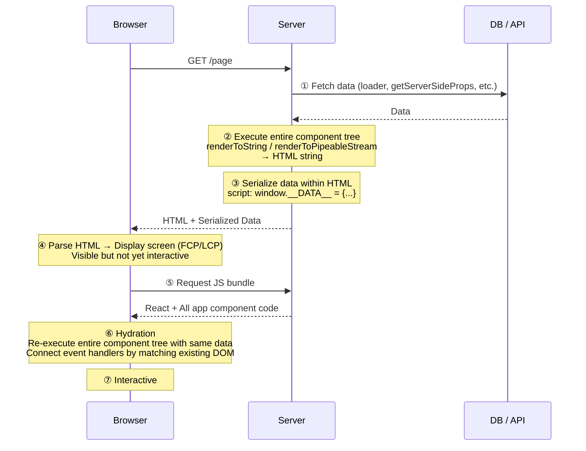
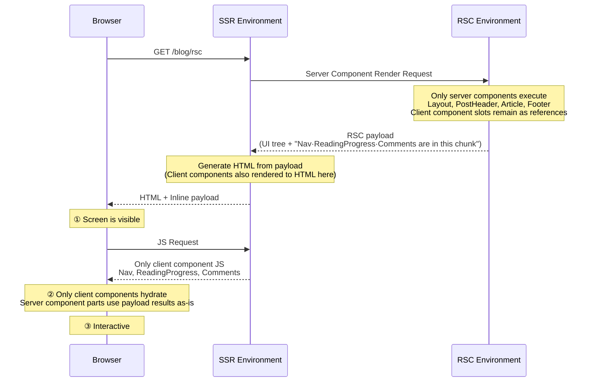
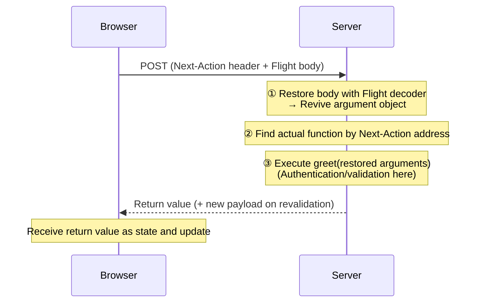

## 0. Exploration Background

Both at my company and on this blog, we use React Router v7. Because of this, I only knew React Server Components (RSC) as "that thing in Next.js App Router."

However, there were continuous discussions about slow app loading. When performance comes up, the phrase "using server components reduces the bundle size" naturally follows. But is that really true? Is the slowness we're experiencing the kind that RSC can alleviate?

This article started from that question. I'll systematically examine what problems SSR left behind and how RSC solved them differently, what exactly the RSC payload sent by the server is, and how server components and client components interact. Finally, I'll apply this understanding to my blog to make a judgment.

## 1. What SSR Solved and What it Left Behind

We often hear explanations like "RSC improves SEO and speeds up initial loading." However, these are benefits already gained with SSR. To understand why RSC emerged, we need to look at what SSR achieved.

### How SSR Works

SSR (Server-Side Rendering) is a method where **React components are executed on the server to first create and send HTML, and then the same components are re-executed in the browser to turn it into a live application.** Next.js Pages Router, Remix, and React Router Framework Mode all follow this structure. A single page request typically flows like this:



There are three key points in the diagram:

-   **①** Components are rendered synchronously, so necessary data is gathered beforehand. This is why frameworks have a **data layer outside components** like `loader` or `getServerSideProps`.
-   **③** For the browser to hydrate, it must render with the exact same data as the server to ensure consistency. Therefore, the data fetched in ① is embedded as JSON within the HTML.
-   **⑤~⑥** To hydrate, **all component code** that makes up the page is needed. This includes all libraries imported by those components. `hydrateRoot` re-executes the entire tree with this code, attaches event handlers to the existing DOM, and blocks the main thread during this process.

In code, it looks like this:

```typescript
// Server
const data = await loader(request);
const html = renderToString(<App data={data} />);
res.send(`
  <div id="root">${html}</div>
  <script>window.__DATA__ = ${JSON.stringify(data)}</script>
  <script src="/bundle.js"></script>
`);

// Browser (bundle.js)
hydrateRoot(document.getElementById("root"), <App data={window.__DATA__} />);
```

### SSR's HTML is Not a Finished Product

Here's an important perspective: In the JSP or PHP era of server rendering, the HTML itself was the finished product. The browser simply received and displayed it, with separate scripts handling interactions.

Modern SSR is different. **The core of the application is still a client-side React app, and the HTML sent by the server is a snapshot that pre-renders its initial screen.** The app only becomes functional after the JS arrives and the same component tree takes over (hydrates) that HTML.

Therefore, modern SSR is less of a "server-rendered app" and more of an **initial screen optimization for CSR apps.**

### Costs Left by SSR

The limitations of this structure are clear:

-   **Bundle size does not decrease.** Even static content like blog post bodies, product descriptions, and footers that won't change after being rendered once, are all sent down as JS and hydrated. Code that only needs to produce a result, like a Markdown parser or date formatting library, also goes along.
-   **Data is sent twice.** Once within the HTML, and again as serialized data for hydration.
-   **Data requirements are hoisted to the route level.** Data needed by deeply nested components must be gathered in `loader` or `getServerSideProps` beforehand and passed down as props. This separates components from the data they use.
-   **The client re-executes what the server has already rendered.** Even parts that will never change.

Ultimately, SSR was merely an **"optimization to display the first screen quickly,"** but it did not reduce the costs borne by the client itself.

## 2. RSC Changed the Question

At this point, the React team changed the question. Instead of "Should the first screen be rendered on the server?", it became **"Does this component even need to go to the client?"**

The answer, unveiled in December 2020 under the name "Zero-Bundle-Size React Server Components," is as follows:

-   Components without interaction **execute only on the server** and only their results are sent. Their code and dependencies are not included in the bundle, nor are they re-executed on the client.
-   Components **fetch data directly.** There's no need to centralize data requirements at the route level.
-   The result is delivered not as HTML, but as an **RSC payload**, which is merged into the live React tree. This allows the client to receive server results while maintaining client-side state, even when navigating between pages.

### Not in Competition with SSR

This often leads to a common misunderstanding: server components do not replace SSR. They answer different questions.

|           | SSR                      | Server Components           |
| --------- | ------------------------ | --------------------------- |
| Question Answered | Where should the initial HTML be created? | Where should this component be executed? |
| Application Time | First request            | First request + subsequent navigation |
| Output      | HTML                     | RSC payload               |
| Component Code | All goes to client       | Server components do not go |
| Hydration | Entire tree              | Only client components      |

In fact, Next.js App Router uses both together. Server components create the payload, and SSR uses that payload to generate the initial HTML. Client components are also SSR'd on the first request.

### RSC from the Perspective of a Blog Post Page

Let's assume this blog's article page consists of the following components:

| Component                             | What it does                                            | Interaction |
| -------------------------------- | ----------------------------------------------- | ---- |
| `Layout`, `PostHeader`, `Footer` | Static markup like title, date, tags                      | None   |
| `Article`                        | Converts Markdown to HTML (unified, remark, rehype, highlighter) | None   |
| `Nav`                            | Menu, language switching                                       | Yes    |
| `ReadingProgress`                | Updates progress bar based on scroll position                  | Yes    |
| `Comments`                       | Comment widget                                           | Yes    |



Server components execute only on the server, and the browser only receives their **results (RSC payload)**. In this process, Markdown libraries that would have been included in the bundle with SSR do not go to the client. Bundle size is reduced, and since only the `Article` part needs to be hydrated, the time to interactivity is brought forward.

In short, **SSR optimized "when to show," while RSC optimized "what to send."**

## 3. CSR / SSR / RSC — What's Different

I compared the three approaches on the same timeline.


-   **CSR**: Receives empty HTML, downloads and executes JS, and only then does the browser request the API. This adds another round trip, so content appears latest.
-   **SSR**: Fetches data on the server and sends HTML, so content appears quickly. However, it requires downloading all app JS and hydrating the entire tree before it becomes interactive. This "visible but not interactive" period is the cost of SSR.
-   **RSC**: The data fetching location and response time are the same as SSR. The difference is what happens next. Server components are excluded from the bundle and hydration target, shortening that period.

| Metric             | CSR         | SSR               | RSC            |
| -------------- | ----------- | ----------------- | -------------- |
| TTFB           | Fast (empty HTML) | Slower by server work | Same as SSR or slightly slower |
| FCP · LCP      | Slow          | Fast                | Same as SSR        |
| TBT · INP during loading | As much as bundle execution | Bundle + full hydration | As much as client components |

Summarizing what goes over the network:

|           | What goes over the network                          |
| --------- | ----------------------------------- |
| CSR       | Empty HTML + All app JS + JSON             |
| SSR       | HTML + All app JS + Serialized data           |
| SSR + RSC | HTML + RSC payload + Only client component JS |

In summary, **SSR accelerates "visible speed" (FCP, LCP), and RSC adds "usable speed" (TBT, INP) to that.** However, the effect only occurs to the extent that components are moved to server components, and the response size can be larger or smaller than SSR depending on the data format.

## 4. What is an RSC payload

When explaining RSC, the RSC payload is constantly mentioned. Simply put, it's data that represents the entire UI tree. So why does RSC need a UI Tree generated on the server?

### SSR hydration

Hydration is the process of re-executing React code exactly as it was on the server, on top of the HTML generated by the server.

In other words, it's a recursive process that performs hydration on **each element object, starting from the Root.**

```javascript
hydrateRoot(root, <App data={window.__DATA__} />)
//                 ↑ { type: App, props: {...} } — function
```

Executing `App` leads to `ProductPage`, which is also a function, so it's executed again... This process **continues to follow function branches all the way down.** This is why all component code that makes up the page must be in the bundle.

However, the goal of server components is not to send code to the client. Even if we only want to hydrate client components, React needs to know where they are in the tree and what their siblings are to match them with the DOM.

**Therefore, the server sends the entire tree's structure as data. That's the RSC payload.**

```javascript
0:["$","div",null,{"children":[["$","h1",null,{"children":"Async Component"}],["$","$1",null,{"fallback":["$","p",null,{"children":"Loading..."}],"children":"$L2"}]]}]
```

### Why was a new format (Flight) needed?

In short, existing data formats could not encapsulate what was needed to express React's tree structure.

```javascript
//jsx
<main>
  <h1>RSC 탐구기</h1>
  <p>본문</p>
</main>

//compiled form
{
  type: "main",
  props: {
    children: [
      { type: "h1", props: { children: "RSC 탐구기" } },
      { type: "p",  props: { children: "본문" } },
    ],
  },
}
```

Looking at the example above, the UI tree itself is a data tree that can be expressed in JSON, but there are two problems with sending React's Tree structure over a network request:

**1. A function can appear in the `type` field.**

```javascript
<Counter initial={0} />
// → { type: Counter, props: { initial: 0 } }
//          ↑ The function itself, not a string
```

HTML tags like `"h1"` are strings, which is fine. But components are functions, and functions cannot be serialized to JSON.

So, RSC sends **only "which export of which module" instead of the function itself.** In the actual payload, it looks like this:

```plain text
1:I["/src/counter.tsx",["/assets/counter.js"],"Counter"]
0:["$","$L1",null,{"initial":0}]
```

**2. Asynchronous components are mixed in.**

Server components can be `async`. If fetching comments takes 3 seconds, that tree will only be complete after 3 seconds. Since JSON must be a complete string to be `JSON.parse`d, even if everything else is ready, you'd have to wait 3 seconds.

In summary, to send a UI tree, two things must be added to JSON:

| Needed              | JSON          | RSC payload   |
| ------------------ | ------------- | ------------- |
| Nested UI structure          | O             | O             |
| Point to client components   | X (cannot serialize functions) | Module reference (`I` line) |
| Send unfinished parts first | X (must be complete to parse)   | Placeholder + later line  |

The solution to the first problem is the module reference we just saw, and the solution to the second problem will be discussed later.

>
> The official name for this format is **Flight**. It's the name used internally in the React repo and is implemented in the `react-server` and `react-client` packages. It's an implementation detail, not a public specification, so it may change with versions.
>
> The "RSC payload" used in Next.js documentation refers to the serialized output in this format. At the HTTP level, it's sent with `Content-Type: text/x-component`.
>

### Streaming

Streaming is an indispensable concept when explaining RSC.

Streaming is a method that allows UI to be progressively rendered from the server, expressed as `transfer-Encoding: chunked` in the HTTP response.

While streaming techniques ultimately involve progressively fetching and completing data, how to stream the UI tree requires a bit more thought.

Dan Abramov's [Progressive JSON](https://overreacted.io/progressive-json/) article kindly explains how objects can be streamed based on the JSON format.

> Dan Abramov's "Progressive JSON" is not a separate format but **a name given to explain the same concept.** The article starts from ordinary JSON, progressively derives Flight's serialization strategy, and finally states that this is essentially how RSC works. However, the scope of the article covers only the serialization strategy; the module references seen above are added on top of that.

Without streaming, if fetching comments takes 3 seconds, you'd have to wait 3 seconds for the already prepared header and footer.

So, applying streaming and simply sending data sequentially from top to bottom would face the problem of JSON's completeness (the same applies to streaming HTML).

```plain text
// t=0s, server sent as much as it could
{"header":"Welcome to my blog","post":{"content":"This is my article","comments":
```

The bracket isn't closed, and putting this into `JSON.parse` would result in a `SyntaxError`. Each fragment isn't a complete value in itself, so the receiver can't do anything. It's no different from waiting for everything to arrive.

Even if a custom parser were used, a more fundamental problem remains. When the `comments` slot is empty, there's no way to distinguish if it's "a value that was never there" or "a value that hasn't arrived yet." The format lacks a way to express "not yet."

Therefore, the unit of splitting is changed. Instead of cutting a monolithic JSON in the middle, it's divided into self-contained fragments (lines) from the start, and unknown slots are explicitly marked with placeholders.

```javascript
// First line (root)
{ header: "$1", post: "$2", footer: "$3" }
/* $1 */ "Welcome to my blog"
/* $3 */ "Hope you like it"
/* $2 */ { content: "$4", comments: "$5" }
/* $4 */ "This is my article"
/* $5 */ ["$6", "$7"]
/* $6 */ "First comment"
/* $7 */ "Second comment"
```

This changes three things:

-   Each line is a self-contained JSON. There are no half-arrived lines. One line arrives, and it can be `JSON.parse`d immediately.
-   **Unknown parts are explicitly "not yet arrived."** `"$2"` is a promise that it will arrive later, so there's no confusion with missing data.
-   Lines arrive in any order, as they become ready. In the example above, `$3` (footer) arrived before `$2` (post). Slow comments do not block the footer.

One thing here can be confusing. `/* $1 */` looks like a separate chunk, making it seem like **another request is sent or the server re-executes** to receive later lines.

Neither is true. **One request, one execution, and one response.** The placeholder marks a part that hasn't finished in that single execution, and later lines are the results of the same execution continuing. The server keeps the response open and writes to the same stream. The response ends when all remaining placeholders are filled.

When the receiver encounters `"$2"`, it inserts a **pending Promise** in that slot, and resolves it when the `$2` line arrives later.

```javascript
// After receiving only the first line
{
  header: "Welcome to my blog",
  post: Promise<pending>,
  footer: "Hope you like it",
}

// After receiving up to the $2 line
{
  header: "Welcome to my blog",
  post: { content: "This is my article", comments: Promise<pending> },
  footer: "Hope you like it",
}
```

With this method, types don't lie. `post` is not an incomplete object but a Promise that hasn't resolved yet. The code can `await` it or wait with `use()`.

The RSC payload **applies this method to the UI tree.** The module references seen earlier are added to this. The actual response looks like this:

```plain text
1:I["/src/client-tabs.tsx",["/assets/client-tabs.js"],"ClientTabs"]
0:["$","main",null,{"children":[["$","h1",null,{"children":"Welcome"}],["$","$L1",null,{"children":"$L2"}]]}]
2:["$","article",null,{"children":"본문..."}]
```

### What's included in an RSC payload

As seen above, the role of the payload is to tell the client "what is where" so it can reconstruct the tree. Therefore, what's included are the contents necessary for that reconstruction.

-   **Execution results of server components**
    -   Functions disappear, leaving only the returned host elements (`article`, `h1`...)
-   **Slots for client components**
    -   Marked with placeholders (`$L1`)
-   **What to put in those slots**
    -   Module references (`I` line). Which export from which chunk.
-   **Props to pass to that component**
    -   Values passed from server to client must be serializable.

Frameworks add their own information here. For Next.js, this might include router state or resource preload hints.

> These four points also explain the difference between `children` and `import`. A server component passed as `children` to a client component has already finished execution, so only its **result** is written, unrelated to the bundle. On the other hand, if a client file `import`s a module, that module goes into the client bundle, and at that moment, it becomes a client component to be written as an `I` line, which requires caution.

Dan Abramov's [RSC Explorer](https://rscexplorer.dev/) shows server code and its corresponding Flight output side-by-side. I've summarized a set of examples.

**1. Client Component**

```javascript
import { Counter } from './client'

export default function App() {
  return (
    <div>
      <h1>Counter</h1>
      <Counter initialCount={0} />
    </div>
  )
}
```

```plain text
1:I["client",[],"Counter"]
0:["$","div",null,{"children":[["$","h1",null,{"children":"Counter"}],["$","$L1",null,{"initialCount":0}]]}]
```

-   `h1` is the result of server execution, so its **content is included as-is**.
-   `Counter` is included as a **reference** `1:I["client",[],"Counter"]` instead of code. This means "fetch the Counter export from the client module."
-   In the tree, `"$L1"` points to that slot, and `{"initialCount":0}` are the **props to pass**.

**2. async component + Suspense**

```javascript
export default function App() {
  return (
    <div>
      <h1>Async Component</h1>
      <Suspense fallback={<p>Loading...</p>}>
        <SlowComponent />
      </Suspense>
    </div>
  )
}

async function SlowComponent() {
  await new Promise(r => setTimeout(r, 500))
  return <p>Data loaded!</p>
}
```

```plain text
1:"$Sreact.suspense"
0:["$","div",null,{"children":[["$","h1",null,{"children":"Async Component"}],["$","$1",null,{"fallback":["$","p",null,{"children":"Loading..."}],"children":"$L2"}]]}]
2:["$","p",null,{"children":"Data loaded!"}]
```

-   Line `1:` is a React built-in symbol for `Suspense`, and `"$1"` in the tree **uses that value directly**.
-   `"$L2"` is a **hole** pointing to line 2. Line 0 goes out first, and line 2 arrives 500ms later.
-   During that time, the client displays the `fallback`.

The difference between `$1` and `$L2` is evident here. Both point to lines, but `$L` carries the meaning **"might not have arrived yet."**

**3. Server Function — Reverse Reference**

```javascript
import { Form } from './client'

export default function App() {
  return (
    <div>
      <h1>Form Action</h1>
      <Form greetAction={greet} />
    </div>
  )
}

async function greet(prevState, formData) {
  'use server'
  const name = formData.get('name')
  return { message: `Hello, ${name}!`, error: null }
}
```

```plain text
1:I["client",[],"Form"]
2:{"id":"greet#greet","bound":null}
0:["$","div",null,{"children":[["$","h1",null,{"children":"Form Action"}],["$","$L1",null,{"greetAction":"$h2"}]]}]
```

-   Line `2:` is a server function reference. Only the **identifier** (`greet#greet`) is included, not the function body.
-   `"$h2"` in props points to that line. The client revives this as "a function that sends a request to the server when called."
-   If `I` lines are "the server pointing to client code," this is the **reverse direction**.

In summary, the table below shows the differences.

|             | SSR           | RSC                             |
| ----------- | ------------- | ------------------------------- |
| Server sends   | Data (ingredients)      | Tree (results)                         |
| Client does | Re-executes everything to create tree | Creates tree from payload + executes only client components |

> **HTTP/2 lowered the cost of streaming**
>
> Streaming itself is possible with `Transfer-Encoding: chunked` in HTTP/1.1. The problem is that one connection handles only one response at a time. An HTML stream open for 3 seconds holds one of the approximately 6 connections per domain, causing JS, CSS, and image requests to queue up.
>
> HTTP/2 splits messages into frames and attaches a stream ID to each frame, allowing multiple requests and responses to be interleaved over a single connection (multiplexing). If the browser requests JS after seeing `<link rel="modulepreload">` sent in the early part of the document by the server, the JS is received first over the same connection where the HTML stream is open.
>

## 5. Reverse Direction: Server Function

So far, we've only looked at the server → client direction. The payload was created on the server and sent to the browser, which decoded it. Server Function is the case where the **direction is reversed.**

We already saw its place in Example 3 of Chapter 4.

```plain text
2:{"id":"greet#greet","bound":null}
0:[..., ["$","$L1",null,{"greetAction":"$h2"}]]
```

A function with `'use server'` is carried in the payload not as its **body, but as an identifier** (`greet#greet`). The `$h2` in the props points to that line. Just as server components send results instead of code, server functions send an **address** instead of code.

### Reviving the address as a "calling function"

When the browser encounters `$h2`, React revives it as a **shell that looks like a normal async function.** From the perspective of the receiving `Form` component, it's just an async function received as a prop. But the body of that function only exists on the server, and what the shell does is one thing — **when called, it sends a request to the server.**

```javascript
// What React creates from the $h reference (conceptual)
async function greet(...args) {
  return fetch(현재경로, {
    method: "POST",
    headers: { "Next-Action": "greet#greet" },   // Which function
    body: Flight로_인코딩(args),                   // Arguments as Flight
  })
}
```

You've received a phone number (address) and a "phone that connects you when you dial," not the other party themselves.

### Call: Arguments go via Flight, server decodes

Calling `greet(formData)` sends a POST request. Two things stand out here:

-   The **address is in the header** (`Next-Action`), and the **arguments are in the body.** They are in different places.
-   Arguments are **encoded with Flight**, not JSON. This allows `Date`, `Map`, `File`, etc., to be passed as-is.

The server processes the received request in this order:



In Chapter 4, the browser decoded, but in this direction, the **server decodes.** This is why decoders exist on both sides. React implements these as `ReactFlightClient` (server → client) and `FlightReplyServer` (client → server), respectively.

> In December 2025, a critical vulnerability emerged in this Server Function path (**CVE-2025-55182**, CVSS 10.0). It allowed arbitrary code execution on the server with a single HTTP request without authentication.
>
> Looking at the structure, it's clear why it could happen. In the rendering direction, the server **creates** the payload, so it handles what it created. However, in the Server Function direction, the server **restores** a payload that came from outside. And there's no guarantee that the sender of the request is a genuine React client — a manipulated body could be sent via `curl`.
>
> The React core patch ([PR #35277](https://github.com/facebook/react/pull/35277)) directly shows the cause. It stated that "`FlightReplyServer` (client→server) and `ReactFlightClient` (server→client) were not 100% symmetrical," and the protection already present in the rendering direction decoder was **belatedly moved to the reverse direction decoder** to fix it. That is, the defense that was present on the browser's receiving side was missing on the server's receiving side.
>
> [React2Shell Analysis (AhnLab ASEC)](https://asec.ahnlab.com/ko/91660/)
>

## 6. Conclusion — RSC is Not the Answer

This blog post started from the flow: "The app is slow → the bundle is large → let's reduce it with RSC." However, upon closer inspection, a large bundle wasn't a problem that RSC conversion alone could solve. Server-only code was already outside the bundle in `.server.ts`, and the biggest cost was not the bundle itself, but things like 3 MB of fonts, which were invisible until measured.

The lesson from TanStack's article ([Original](https://tanstack.com/blog/we-stopped-using-rsc-on-tanstack-com)) about introducing and then removing RSC on [tanstack.com](http://tanstack.com/) is the same. It's better to first identify the actual bottleneck than to cover up problems by changing the architecture. Most of their improvements came from "the renderer is too heavy," not RSC, and once the renderer was made lighter, RSC no longer justified its cost.

RSC is undoubtedly a well-designed next-generation architecture. However, for a blog like ours, where the goal is simply "to hide server-only modules from the client," SSR, which sends HTML generated on the server, might be sufficient. This is even more true if hydration isn't strictly necessary. Ultimately, the decision to use RSC or not should be made after first measuring "what kind of slowness our app experiences," rather than simply asking "is RSC good?"

## References

-   [Progressive JSON — overreacted](https://overreacted.io/progressive-json/)
-   [Static as a Server — overreacted](https://overreacted.io/static-as-a-server/)
-   [Introducing RSC Explorer — overreacted](https://overreacted.io/introducing-rsc-explorer/)
-   [Server Components — React official documentation](https://react.dev/reference/rsc/server-components) ("Server Components without a Server" section)
-   [Server and Client Components — Next.js](https://nextjs.org/docs/app/getting-started/server-and-client-components) ("On the client (first load)" step 3)
-   [Static Exports — Next.js](https://nextjs.org/docs/app/guides/static-exports)
-   [Why do I need RSC payload for Server Components — next.js Discussion #67499](https://github.com/vercel/next.js/discussions/67499)
-   [React Server Components — React Router](https://reactrouter.com/how-to/react-server-components)
-   [Critical Security Vulnerability in React Server Components — React official blog](https://react.dev/blog/2025/12/03/critical-security-vulnerability-in-react-server-components)
-   [New Suspense SSR Architecture in React 18 — reactwg](https://github.com/reactwg/react-18/discussions/37)