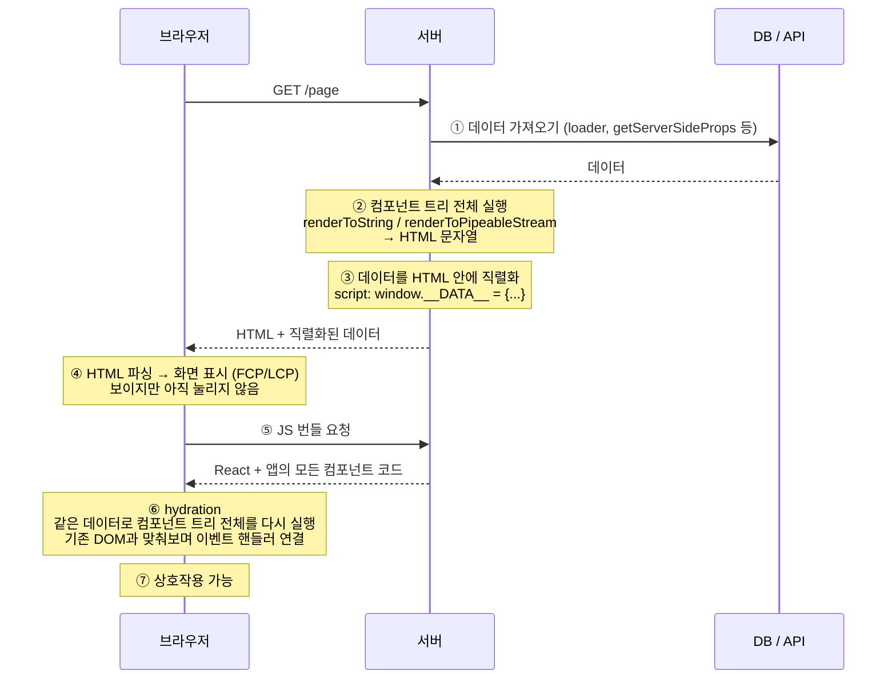
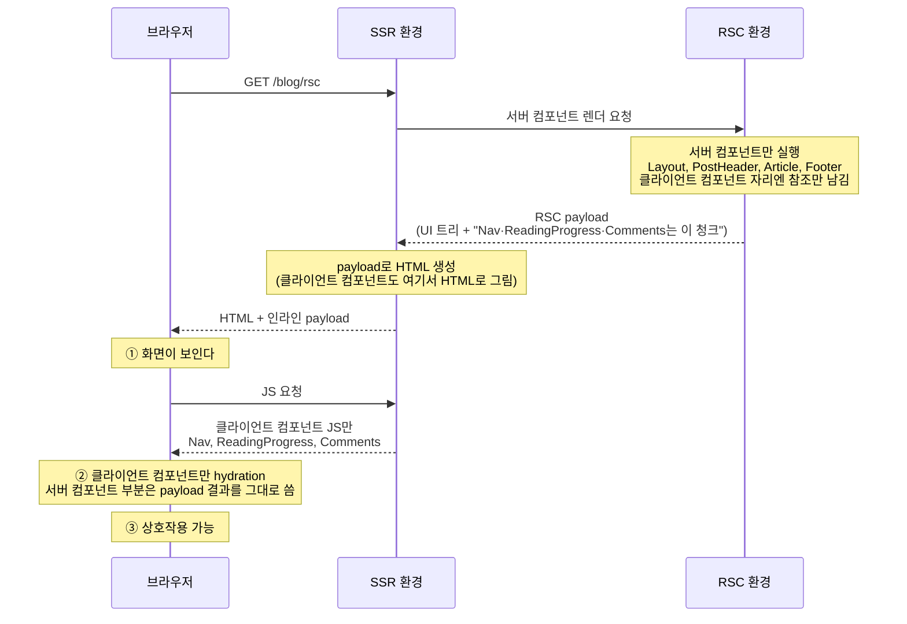
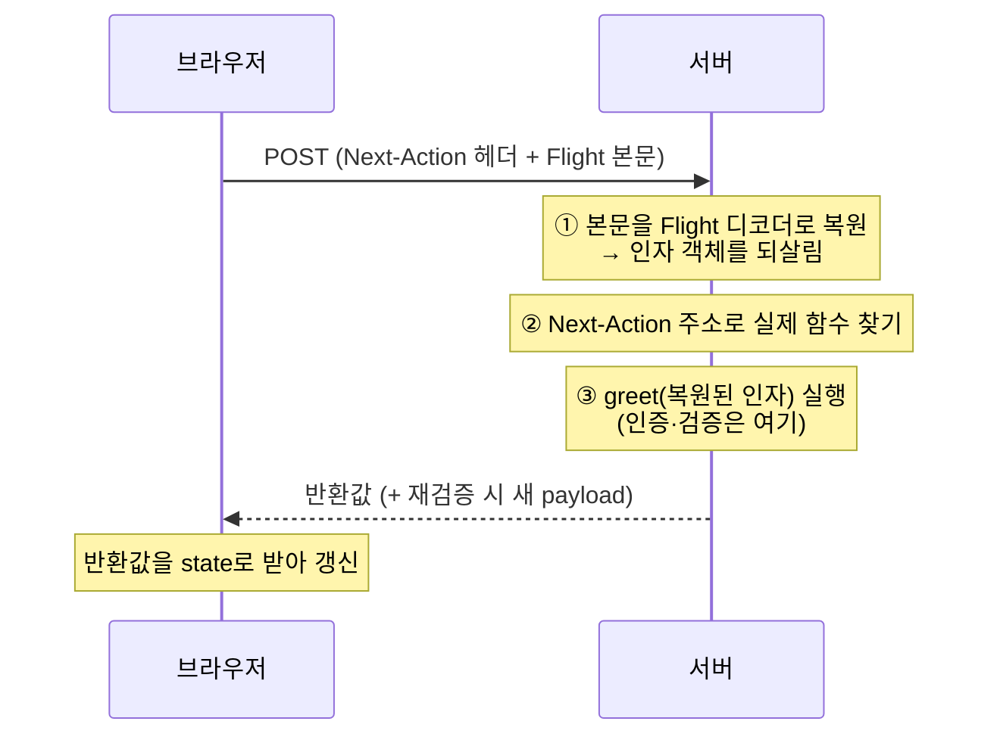

## 0. 탐구 배경


회사에서도, 이 블로그에서도 React Router v7을 쓰고 있다. 그래서 React Server Components(RSC)는 "Next.js App Router에 있는 그거" 정도로만 알고 있었다.


그러다 앱 로딩이 느리다는 얘기가 계속 나왔다. 성능 얘기가 나오면 "서버 컴포넌트 쓰면 번들이 줄어든다"는 말이 자연스럽게 따라온다. 그런데 정말 그럴까? 우리가 겪는 느림이 RSC로 줄어드는 종류의 느림일까?


이 글은 그 질문에서 출발했다. SSR이 남긴 문제가 무엇이었고 RSC가 그걸 어떻게 다르게 풀었는지, 서버가 보내는 RSC payload가 정확히 무엇인지, 서버 컴포넌트와 클라이언트 컴포넌트는 어떻게 맞물리는지 차례로 뜯어보고, 마지막에 내 블로그에 실제로 대입해 판단해본다.


## 1. SSR은 무엇을 해결했고 무엇을 남겼나


"RSC 쓰면 SEO 좋아지고 초기 로딩 빨라진다"는 설명을 자주 듣는다. 그런데 그건 SSR로도 이미 얻고 있는 것들이다. SSR이 어디까지 해결했는지를 봐야 RSC가 왜 나왔는지 보인다.


### SSR의 동작 과정


SSR(Server-Side Rendering)은 **서버에서 React 컴포넌트를 실행해 HTML을 먼저 만들어 보내고 브라우저에서 같은 컴포넌트를 다시 실행해 살아 있는 앱으로 만드는** 방식이다. Next.js Pages Router, Remix, React Router Framework Mode가 모두 이 구조다. 한 번의 페이지 요청은 대략 이렇게 흘러간다.





그림에서 짚어둘 곳은 세 군데다.

- **①** 컴포넌트는 동기적으로 렌더링되므로 렌더링 전에 필요한 데이터를 미리 모은다. 그래서 프레임워크마다 `loader`, `getServerSideProps` 같은 **컴포넌트 바깥의 데이터 계층**이 있다.
- **③** 브라우저가 hydration할 때 서버와 똑같은 데이터로 렌더링해야 결과가 일치한다. 그래서 ①에서 가져온 데이터를 JSON으로 HTML 안에 심어 보낸다.
- **⑤~⑥** hydration하려면 페이지를 이루는 **모든 컴포넌트의 코드**가 필요하다. 그 컴포넌트가 import한 라이브러리까지 전부다. `hydrateRoot`는 이 코드로 트리 전체를 다시 실행해 이미 있는 DOM에 이벤트 핸들러를 붙이고 그동안 메인 스레드를 막는다.

코드로 줄이면 이렇다.


```typescript
// 서버
const data = await loader(request);
const html = renderToString(<App data={data} />);
res.send(`
  <div id="root">${html}</div>
  <script>window.__DATA__ = ${JSON.stringify(data)}</script>
  <script src="/bundle.js"></script>
`);

// 브라우저 (bundle.js)
hydrateRoot(document.getElementById("root"), <App data={window.__DATA__} />);
```


### SSR의 HTML은 완성품이 아니다


여기서 중요한 관점 하나. JSP나 PHP 시절의 서버 렌더링은 HTML 자체가 완성품이었다. 브라우저는 받아서 보여주면 끝이고, 인터랙션은 별도로 붙인 스크립트가 맡았다.


현대 SSR은 다르다. **앱의 본체는 여전히 클라이언트의 React 앱이고, 서버가 보낸 HTML은 그 첫 화면을 미리 찍어 보낸 스냅샷이다.** JS가 도착해 같은 컴포넌트 트리가 그 HTML을 인수(hydration)하고 나서야 앱이 동작한다.


그래서 현대 SSR은 "서버 렌더링 앱"이라기보다 **CSR 앱의 첫 화면 최적화**에 가깝다.


### SSR이 남기는 비용


이 구조에서 오는 한계는 분명하다.

- **번들 크기는 줄지 않는다.** 한 번 그리면 바뀔 일 없는 게시글 본문, 상품 설명, 푸터까지 전부 JS로 내려가 hydration된다. 마크다운 파서나 날짜 포맷 라이브러리처럼 결과만 필요한 코드도 같이 간다.
- **데이터가 두 번 간다.** HTML 안에 한 번, hydration을 위해 직렬화된 데이터로 또 한 번.
- **데이터 요구가 라우트로 끌어올려진다.** 깊은 곳의 컴포넌트가 필요한 데이터까지 `loader`나 `getServerSideProps`에서 미리 모아 props로 내려야 한다. 컴포넌트와 그 컴포넌트가 쓰는 데이터가 멀어진다.
- **서버가 이미 그린 것을 클라이언트가 다시 실행한다.** 결과가 바뀔 일 없는 부분까지도.

결국 SSR은 **"첫 화면을 빨리 보여주는 최적화"**였을 뿐, 클라이언트가 떠안는 비용 자체를 줄이지는 못했다.


## 2. RSC는 질문을 바꿨다


여기서 React 팀은 질문을 바꿨다. "첫 화면을 서버에서 그릴까?"가 아니라 **"이 컴포넌트는 애초에 클라이언트에 갈 필요가 있나?"**


2020년 12월 "Zero-Bundle-Size React Server Components"라는 이름으로 공개된 답은 이렇다.

- 인터랙션이 없는 컴포넌트는 **서버에서만 실행**하고 결과만 보낸다. 코드도 의존성도 번들에 들어가지 않고, 클라이언트에서 다시 실행되지도 않는다.
- 컴포넌트가 **직접 데이터를 가져온다.** 라우트에 데이터 요구를 몰아둘 필요가 없다.
- 결과는 HTML이 아니라 **RSC payload**로 전달되어 살아 있는 React 트리에 병합된다. 그래서 페이지를 이동해도 클라이언트 상태를 유지한 채 서버 결과를 받을 수 있다.

### SSR과 경쟁 관계가 아니다


여기서 흔한 오해가 생긴다. 서버 컴포넌트가 SSR을 대체하는 게 아니다. 둘은 서로 다른 질문에 답한다.


|           | SSR              | 서버 컴포넌트           |
| --------- | ---------------- | ----------------- |
| 답하는 질문    | 첫 HTML을 어디서 만들까? | 이 컴포넌트를 어디서 실행할까? |
| 적용 시점     | 첫 요청             | 첫 요청 + 이후 네비게이션   |
| 결과물       | HTML             | RSC payload       |
| 컴포넌트 코드   | 전부 클라이언트로 감      | 서버 컴포넌트는 가지 않음    |
| hydration | 트리 전체            | 클라이언트 컴포넌트만       |


실제로 Next.js App Router는 둘을 함께 쓴다. 서버 컴포넌트가 payload를 만들고, SSR이 그 payload로 첫 HTML을 만든다. 클라이언트 컴포넌트도 첫 요청에서는 SSR된다.


### 블로그 글 페이지로 본 RSC


이 블로그의 글 페이지가 아래 컴포넌트로 이뤄져 있다고 가정해보았다.


| 컴포넌트                             | 하는 일                                            | 상호작용 |
| -------------------------------- | ----------------------------------------------- | ---- |
| `Layout`, `PostHeader`, `Footer` | 제목·날짜·태그 같은 정적 마크업                              | 없음   |
| `Article`                        | 마크다운을 HTML로 변환 (unified, remark, rehype, 하이라이터) | 없음   |
| `Nav`                            | 메뉴, 언어 전환                                       | 있음   |
| `ReadingProgress`                | 스크롤에 따라 진행 바 갱신                                 | 있음   |
| `Comments`                       | 댓글 위젯                                           | 있음   |





서버 컴포넌트는 서버에서만 실행되고 브라우저는 그 **결과(RSC payload)** 만 받는다. 그 과정에서 SSR이라면 번들에 포함됐을 마크다운 라이브러리가 클라이언트로 가지 않는다. 번들 크기는 줄고, `Article` 부분을 제외한 나머지만 hydration하면 되니 상호작용 가능 시점이 앞당겨진다.


한 줄로 줄이면, **SSR은 "언제 보여줄까"를 최적화했고 RSC는 "무엇을 보낼까"를 최적화한다.**


## 3. CSR / SSR / RSC — 무엇이 다른가


같은 타임테이블에서 세 방식을 비교해보았다.


- **CSR**: 빈 HTML을 받고 JS를 내려받아 실행한 뒤에야 브라우저가 API를 요청한다. 왕복이 한 번 더 생겨서 콘텐츠가 가장 늦게 보인다.
- **SSR**: 서버에서 데이터를 가져와 HTML을 만들어 보내니 콘텐츠가 빨리 보인다. 하지만 앱 전체 JS를 받아 트리 전체를 hydration해야 눌린다. 이 "보이지만 안 눌리는 구간"이 SSR의 비용이다.
- **RSC**: 데이터를 가져오는 위치와 응답 시점은 SSR과 같다. 차이는 그 뒤다. 서버 컴포넌트는 번들과 hydration 대상에서 빠지므로 그 구간이 짧아진다.

| 지표             | CSR         | SSR               | RSC            |
| -------------- | ----------- | ----------------- | -------------- |
| TTFB           | 빠름 (빈 HTML) | 서버 작업만큼 늦음        | SSR과 같거나 조금 늦음 |
| FCP · LCP      | 늦음          | 빠름                | SSR과 같음        |
| TBT · 로딩 중 INP | 번들 실행만큼     | 번들 + 전체 hydration | 클라이언트 컴포넌트만큼   |


네트워크로 무엇이 가는지로 정리하면 이렇다.


|           | 네트워크로 가는 것                          |
| --------- | ----------------------------------- |
| CSR       | 빈 HTML + 앱 전체 JS + JSON             |
| SSR       | HTML + 앱 전체 JS + 직렬화된 데이터           |
| SSR + RSC | HTML + RSC payload + 클라이언트 컴포넌트 JS만 |


정리하면 **SSR은 "보이는 속도"(FCP, LCP)를 당기고, RSC는 여기에 "쓸 수 있는 속도"(TBT, INP)를 더한다.** 단 효과는 서버 컴포넌트로 옮긴 비중만큼만 생기고, 응답 크기는 데이터 형태에 따라 SSR보다 크거나 작을 수 있다.


## 4. RSC payload란 무엇인가


RSC를 설명하다 보면 RSC payload를 계속 언급하게 되는데, 간단하게 설명하면 전체 UI tree를 보여주는 데이터이다. 그렇다면 왜 RSC에서는 서버에서 생성한 UI Tree가 필요할까?


### SSR hydration


hydration은 서버가 만든 HTML 위에 React 코드를 그대로 다시 실행하는 것이다.


다시 말하면 Root부터 **엘리먼트 객체를 하나씩 hydration을 진행하면서 재귀를 도는 과정이다.**


```javascript
hydrateRoot(root, <App data={window.__DATA__} />)
//                 ↑ { type: App, props: {...} } — 함수
```


`App`을 실행하면 `ProductPage`가 나오고, 그것도 함수니까 또 실행하고… 이렇게 **함수 분기를 계속 타면서 끝까지 내려간다.** 그래서 페이지를 이루는 모든 컴포넌트 코드가 번들에 있어야 한다.


그러나 서버 컴포넌트는 코드를 클라이언트에 보내지 않는 게 목적이고, 클라이언트 컴포넌트만 hydration하려 해도 React는 그게 트리의 어디에 있는지, 앞뒤 형제가 무엇인지 알아야 DOM과 짝을 맞출 수 있다.


**그래서 서버가 트리 전체의 모양을 데이터로 보내준다. 그게 RSC payload다.**


```javascript
0:["$","div",null,{"children":[["$","h1",null,{"children":"Async Component"}],["$","$1",null,{"fallback":["$","p",null,{"children":"Loading..."}],"children":"$L2"}]]}]
```


### 왜 새로운 포맷(Flight)이 필요했을까?


한마디로 정리하면 React의 tree 구조를 표현하기위해서는 기존에 사용하는 데이터 포맷으로는 담을 수 있는게 없었다.


```javascript
//jsx
<main>
  <h1>RSC 탐구기</h1>
  <p>본문</p>
</main>

//컴파일된 형태
{
  type: "main",
  props: {
    children: [
      { type: "h1", props: { children: "RSC 탐구기" } },
      { type: "p",  props: { children: "본문" } },
    ],
  },
}
```


위 예시를 보면 UI 트리자체는 JSON으로 표현할 수 있는 데이터 트리지만, React의 Tree구조를 네트워크 요청으로 보내기에는 아래 두가지 문제가 존재한다.


**1.** **`type`** **자리에 함수가 올 수 있다.**


```javascript
<Counter initial={0} />
// → { type: Counter, props: { initial: 0 } }
//          ↑ 문자열이 아니라 함수 그 자체
```


`"h1"` 같은 HTML 태그는 문자열이라 괜찮다. 하지만 컴포넌트는 함수이고 함수는 JSON으로 직렬화할 수 없다.


그래서 RSC는 **함수 대신 "어느 모듈의 어떤 export인지"만** 보낸다. 실제 payload에서는 이렇게 생겼다.


```plain text
1:I["/src/counter.tsx",["/assets/counter.js"],"Counter"]
0:["$","$L1",null,{"initial":0}]
```


**2. 비동기 컴포넌트가 섞여 있다.**


서버 컴포넌트는 `async`일 수 있다. 댓글 조회가 3초 걸린다면 그 트리는 3초 뒤에야 완성된다. JSON은 완성된 문자열이어야 `JSON.parse`할 수 있으니, 나머지가 다 준비돼 있어도 3초를 기다려야 한다.


정리하면 UI 트리를 보내려면 JSON에 두 가지를 더해야 한다.


| 필요한 것              | JSON          | RSC payload   |
| ------------------ | ------------- | ------------- |
| 중첩된 UI 구조          | O             | O             |
| 클라이언트 컴포넌트를 가리키기   | X (함수 직렬화 불가) | 모듈 참조 (`I` 행) |
| 아직 안 끝난 부분을 먼저 보내기 | X (완성돼야 파싱)   | 자리표시자 + 나중 행  |


첫 번째 문제의 해법이 방금 본 모듈 참조이고, 두 번째 문제의 해법은 뒤에서 본다.

> 
>
> 이 포맷의 정식 명칭은 **Flight**다. React 레포 내부에서 쓰는 이름이고 `react-server`·`react-client` 패키지에 구현되어 있다. 공개 스펙이 아니라 구현 디테일이라 버전마다 바뀔 수 있다.
>
>
> Next.js 문서가 쓰는 "RSC payload"는 이 포맷으로 직렬화된 결과물을 가리킨다. HTTP 레벨에서는 `Content-Type: text/x-component`로 나간다.
>
>

### 스트리밍


RSC를 설명하는데 빠질 수 없는 개념이다.


스트리밍은 서버로부터 UI를 점진적으로 렌더링할 수 있도록 해주는 방식으로 http response transfer-Encoding에 chunked라고 표현된다. 


스트리밍 기법이라는게 결국에는 점진적으로 데이터를 가져와서 완성하는 과정이지만, UI 트리를 어떻게 스트리밍해서 보낼까에 대해서는 조금 깊게 생각할 필요가 있다. 


Dan Abramov가 [Progressive JSON](https://overreacted.io/progressive-json/) 글을 보면 JSON 포맷을 기준으로 어떻게 객체를 스트리밍해서 보낼 수 있을까에 대해서 친절하게 잘 설명하고 있다.

> Dan Abramov의 "Progressive JSON"은 별개 포맷이 아니라 **같은 것을 설명하기 위해 붙인 이름**이다. 그 글은 평범한 JSON에서 출발해 Flight의 직렬화 전략을 단계적으로 유도해 보이고, 마지막에 이것이 본질적으로 RSC가 동작하는 방식이라고 밝힌다. 다만 글이 다루는 범위는 직렬화 전략까지이고, 위에서 본 모듈 참조는 그 위에 더해지는 부분이다.

스트리밍을 적용하지 않는다면 댓글 조회에 3초가 걸리면 이미 준비된 헤더와 푸터까지 3초를 기다려야 한다.


그래서 스트리밍을 적용해서 단순히 위에서부터 순차적으로 스트리밍해서 전송한다했을 때의 문제는 JSON의 완결성이다.(HTML을 스트리밍한다해도 마찬가지)


```plain text
// t=0s, 서버가 보낼 수 있는 만큼 보냈다
{"header":"Welcome to my blog","post":{"content":"This is my article","comments":
```


괄호가 닫히지 않았고,  `JSON.parse`에 넣으면 `SyntaxError`다. 조각 하나하나가 그 자체로 완결된 값이 아니라서 받는 쪽이 할 수 있는 일이 없다. 다 올 때까지 기다리는 것과 다르지 않다.


설령 파서를 고쳐 쓴다 해도 더 근본적인 문제가 남는다. `comments` 자리가 비어 있을 때 그게 "원래 없는 값"인지 "아직 안 온 값"인지 구분할 방법이 없다. 포맷 안에 "아직"을 표현할 자리가 없기 때문이다.


그래서 쪼개는 단위를 바꾸는 것이다. 통짜 JSON을 중간에서 자르는 대신, 처음부터 각자 완결된 조각(행)으로 나눠 보내고 아직 모르는 자리는 자리표시자로 명시한다.


```javascript
// 첫 번째 행 (루트)
{ header: "$1", post: "$2", footer: "$3" }
/* $1 */ "Welcome to my blog"
/* $3 */ "Hope you like it"
/* $2 */ { content: "$4", comments: "$5" }
/* $4 */ "This is my article"
/* $5 */ ["$6", "$7"]
/* $6 */ "First comment"
/* $7 */ "Second comment"
```


이렇게 보내면 세 가지가 달라진다.

- 각 행은 그 자체로 완결된 JSON이다. 반쯤 온 행은 없다. 한 행이 오면 바로 `JSON.parse`할 수 있다.
- **모르는 부분은 명시적으로 "아직 안 옴"이다.** `"$2"`는 나중에 온다는 약속이라 누락과 헷갈릴 일이 없다.
- 행은 준비된 순서대로 아무 순서로나 온다. 위 예시에서 `$3`(footer)이 `$2`(post)보다 먼저 왔다. 느린 comments가 footer를 막지 않는다.

여기서 헷갈릴 수 있는 게 하나 있다. `/* $1 */`이 따로 떨어진 덩어리처럼 보여서, 나중 행을 받으려면 **요청을 한 번 더 보내거나 서버가 다시 실행하는 것처럼** 읽힌다.


둘 다 아니다. **요청 한 번에 실행 한 번, 응답도 하나다.** 자리표시자는 그 한 번의 실행에서 아직 안 끝난 부분을 표시한 자리고, 나중에 오는 행은 같은 실행이 이어서 끝난 결과다. 서버는 응답을 닫지 않고 열어둔 채 같은 스트림에 이어 써 보낸다. 남은 자리표시자가 모두 채워지면 그때 응답이 끝난다.


받는 쪽은 `"$2"`를 만나면 그 자리에 **pending Promise**를 끼워 넣고, 나중에 `$2` 행이 도착하면 resolve한다.


```javascript
// 첫 행만 받은 시점
{
  header: "Welcome to my blog",
  post: Promise<pending>,
  footer: "Hope you like it",
}

// $2 행까지 받은 시점
{
  header: "Welcome to my blog",
  post: { content: "This is my article", comments: Promise<pending> },
  footer: "Hope you like it",
}
```


이 방식이면 타입이 거짓말을 하지 않는다. `post`는 불완전한 객체가 아니라 아직 resolve되지 않은 Promise다. 코드는 `await`하거나 `use()`로 기다리면 된다.


RSC payload는 이 방식을 **UI 트리에 적용한 것**이다. 여기에 앞에서 본 모듈 참조가 더해진다. 실제 응답은 이런 모양이다.


```plain text
1:I["/src/client-tabs.tsx",["/assets/client-tabs.js"],"ClientTabs"]
0:["$","main",null,{"children":[["$","h1",null,{"children":"Welcome"}],["$","$L1",null,{"children":"$L2"}]]}]
2:["$","article",null,{"children":"본문..."}]
```


### RSC payload에 담기는 것


위에서 봤던 것 처럼 payload의 역할은 클라이언트가 트리를 복원할 수 있도록 "무엇이 어디에 있는지"를 알려주는 것이다. 그래서 담기는 것도 그 복원에 필요한 내용들이다.

- **서버 컴포넌트의 실행 결과**
    - 함수는 사라지고 반환된 호스트 엘리먼트(`article`, `h1` …)만 남는다
- **클라이언트 컴포넌트가 들어갈 자리**
    - 자리표시자(`$L1`)로 표시된다
- **그 자리에 무엇을 넣을지**
    - 모듈 참조(`I` 행). 어느 청크의 어떤 export인지
- **그 컴포넌트에 넘길 props**
    - 서버에서 클라이언트로 건너가는 값이라 직렬화할 수 있어야 한다

여기에 프레임워크가 자기 정보를 얹는다. Next.js라면 라우터 상태나 리소스 프리로드 힌트 같은 것들이다.

> 이 네 가지가 `children`과 `import`의 차이도 설명해주는데, 클라이언트 컴포넌트의 `children`으로 넘긴 서버 컴포넌트는 이미 실행이 끝나 **결과**만 적힐 뿐이니 번들과 상관없다. 반면 클라이언트 파일에서 `import`하면 그 모듈이 클라이언트 번들에 들어가고, 그 순간 `I` 행으로 적힐 클라이언트 컴포넌트가 되기에 주의해야한다.

Dan Abramov가 만든 [RSC Explorer](https://rscexplorer.dev/)는 서버 코드와 그에 대응하는 Flight 출력을 나란히 보여준다. 예제 셋을 정리해보았다.


**1. 클라이언트 컴포넌트** 


```javascript
import { Counter } from './client'

export default function App() {
  return (
    <div>
      <h1>Counter</h1>
      <Counter initialCount={0} />
    </div>
  )
}
```


```plain text
1:I["client",[],"Counter"]
0:["$","div",null,{"children":[["$","h1",null,{"children":"Counter"}],["$","$L1",null,{"initialCount":0}]]}]
```

- `h1`은 서버에서 실행이 끝난 결과라 **내용이 그대로** 들어갔다
- `Counter`는 코드 대신 `1:I["client",[],"Counter"]`라는 **참조**로 들어갔다. "client 모듈의 Counter export를 가져와라"는 뜻이다
- 트리에서는 `"$L1"`이 그 자리를 가리키고, `{"initialCount":0}`이 **넘길 props**다

**2. async 컴포넌트 + Suspense**


```javascript
export default function App() {
  return (
    <div>
      <h1>Async Component</h1>
      <Suspense fallback={<p>Loading...</p>}>
        <SlowComponent />
      </Suspense>
    </div>
  )
}

async function SlowComponent() {
  await new Promise(r => setTimeout(r, 500))
  return <p>Data loaded!</p>
}
```


```plain text
1:"$Sreact.suspense"
0:["$","div",null,{"children":[["$","h1",null,{"children":"Async Component"}],["$","$1",null,{"fallback":["$","p",null,{"children":"Loading..."}],"children":"$L2"}]]}]
2:["$","p",null,{"children":"Data loaded!"}]
```

- `1:` 행은 `Suspense`라는 React 내장 심볼이고, 트리에서 `"$1"`로 **그 값 자체**를 가져다 쓴다
- `"$L2"`는 2번 행을 가리키는 **구멍**이다. 0번 행이 먼저 나가고 2번 행은 500ms 뒤에 도착한다
- 그 사이 클라이언트는 `fallback`을 보여준다

`$1`과 `$L2`의 차이가 여기서 드러난다. 둘 다 행을 가리키지만 `$L`에는 **"아직 안 왔을 수 있다"**는 뜻이 붙어 있다.


**3. Server Function — 반대 방향 참조**


```javascript
import { Form } from './client'

export default function App() {
  return (
    <div>
      <h1>Form Action</h1>
      <Form greetAction={greet} />
    </div>
  )
}

async function greet(prevState, formData) {
  'use server'
  const name = formData.get('name')
  return { message: `Hello, ${name}!`, error: null }
}
```


```plain text
1:I["client",[],"Form"]
2:{"id":"greet#greet","bound":null}
0:["$","div",null,{"children":[["$","h1",null,{"children":"Form Action"}],["$","$L1",null,{"greetAction":"$h2"}]]}]
```

- `2:` 행이 서버 함수 참조다. 함수 본체가 아니라 **식별자**(`greet#greet`)만 들어간다
- props의 `"$h2"`가 그 행을 가리킨다. 클라이언트는 이걸 "호출하면 서버로 요청을 보내는 함수"로 되살린다
- `I` 행이 "서버가 클라이언트 코드를 가리키는 것"이라면, 이건 **반대 방향**이다

정리하면 아래 표와 같다.


|             | SSR           | RSC                             |
| ----------- | ------------- | ------------------------------- |
| 서버가 보내는 것   | 데이터 (재료)      | 트리 (결과)                         |
| 클라이언트가 하는 일 | 전부 재실행해 트리 생성 | payload로 트리 생성 + 클라이언트 컴포넌트만 실행 |

> **HTTP/2는 스트리밍의 비용을 낮췄다**
>
> HTTP/1.1에서도 `Transfer-Encoding: chunked`로 스트리밍 자체는 된다. 문제는 연결 하나가 한 번에 응답 하나만 처리한다는 점이다. 3초 동안 열려 있는 HTML 스트림이 도메인당 약 6개인 연결 중 하나를 붙잡고, 그만큼 JS·CSS·이미지 요청이 줄을 선다.
>
>
> HTTP/2는 메시지를 프레임으로 쪼개고 프레임마다 stream ID를 붙여, 연결 하나에서 여러 요청·응답을 섞어 보낸다(멀티플렉싱). 서버가 문서 앞부분에 보낸 `<link rel="modulepreload">`를 보고 브라우저가 JS를 요청하면, HTML 스트림이 열려 있는 같은 연결에서 JS가 먼저 받아진다.
>
>

## 5. 반대 방향: Server Function


지금까지는 서버 → 클라이언트 한 방향만 봤다. payload가 서버에서 만들어져 브라우저로 갔고, 브라우저가 그걸 디코딩했다. Server Function은 그 **방향이 뒤집힌** 경우다.


4장 예제 3번에서 이미 그 자리를 봤다.


```plain text
2:{"id":"greet#greet","bound":null}
0:[..., ["$","$L1",null,{"greetAction":"$h2"}]]
```


`'use server'`를 붙인 함수는 payload에 **본체가 아니라 식별자**(`greet#greet`)로 실린다. props의 `$h2`가 그 행을 가리킨다. 서버 컴포넌트가 코드 대신 결과를 보냈듯, 서버 함수는 코드 대신 **주소**를 보낸다.


### 주소를 "전화 거는 함수"로 되살린다


브라우저가 `$h2`를 만나면, React는 이걸 **평범한 async 함수처럼 생긴 껍데기**로 되살린다. 받는 쪽 `Form` 컴포넌트 입장에선 그냥 async 함수 하나를 prop으로 받은 것뿐이다. 하지만 그 함수의 본체는 서버에만 있고, 껍데기가 하는 일은 하나다 — **부르면 서버로 요청을 보낸다.**


```javascript
// React가 $h 참조로부터 만들어주는 것 (개념)
async function greet(...args) {
  return fetch(현재경로, {
    method: "POST",
    headers: { "Next-Action": "greet#greet" },   // 어느 함수인지
    body: Flight로_인코딩(args),                   // 인자를 Flight로
  })
}
```


전화번호(주소)와 "누르면 연결해주는 전화기"를 받은 것이지, 상대방 자체를 받은 게 아니다.


### 호출: 인자가 Flight로 가고, 서버가 디코딩한다


`greet(formData)`를 부르면 POST가 나간다. 여기서 두 가지가 눈에 띈다.

- **주소는 헤더에**(`Next-Action`), **인자는 본문에** 실린다. 서로 다른 자리다.
- 인자는 JSON이 아니라 **Flight로 인코딩**된다. 그래서 `Date`, `Map`, `File` 같은 것도 그대로 넘어간다.

서버는 받은 요청을 이 순서로 처리한다.





4장에선 브라우저가 디코딩했지만, 이 방향은 **서버가 디코딩한다.** 디코더가 양쪽에 다 있는 이유다. React는 이 둘을 각각 `ReactFlightClient`(서버→클라)와 `FlightReplyServer`(클라→서버)로 구현해두었다.

> 2025년 12월, 이 Server Function 경로에서 치명적 취약점이 터졌다(**CVE-2025-55182**, CVSS 10.0). 인증 없이 HTTP 요청 하나로 서버에서 임의 코드를 실행할 수 있었다.  
>   
> 구조를 보면 왜 터질 수밖에 없었는지 보인다. 렌더링 방향에서 서버는 payload를 **만드는** 쪽이라 자기가 만든 걸 다룬다. 그런데 Server Function 방향에서 서버는 **외부에서 온** payload를 복원하는 쪽이 된다. 그리고 요청을 보내는 쪽이 진짜 React 클라이언트라는 보장이 없다 — `curl`로 조작한 본문을 보낼 수 있다.  
> 
>
> React 코어의 패치([PR #35277](https://github.com/facebook/react/pull/35277))가 원인을 그대로 보여준다. "`FlightReplyServer`(클라→서버)와 `ReactFlightClient`(서버→클라)는 100% 대칭이 아니었다"며, 렌더링 방향 디코더에 이미 있던 보호를 **반대 방향 디코더에 뒤늦게 옮겨** 막았다. 즉 브라우저가 받는 쪽엔 있던 방어가, 서버가 받는 쪽엔 빠져 있었다.
>
> [React2Shell 분석 (AhnLab ASEC)](https://asec.ahnlab.com/ko/91660/)
>
>

## 6. 마무리 — RSC는 정답이 아니다


이 블로그는 "앱이 느리다 → 번들이 크다 → RSC로 줄이자"는 흐름에서 출발했다. 그런데 뜯어보니 번들이 크다고 RSC 전환으로 풀 문제가 아니었다. 서버 전용 코드는 이미 `.server.ts`로 번들 밖에 있었고, 정작 가장 큰 비용은 번들이 아니라 글꼴 3 MB처럼 측정하기 전까지 보이지 않던 곳에 있었다.


TanStack이 [tanstack.com](http://tanstack.com/)에서 RSC를 도입했다가 걷어낸 글([원문](https://tanstack.com/blog/we-stopped-using-rsc-on-tanstack-com))의 교훈도 같다. 실제 병목인 지점을 찾아내는 게 먼저지, 아키텍처를 바꿔서 문제를 덮는 건 좋지 않다는 것이다. 그들의 개선 대부분은 RSC가 아니라 "렌더러가 너무 무겁다"에서 나왔고, 렌더러를 가볍게 만들자 RSC는 더 이상 밥값을 하지 못했다.


RSC는 분명 잘 설계된 차세대 아키텍처다. 다만 우리 블로그처럼 목적이 단순히 "서버 전용 모듈을 클라이언트에서 숨기는 것"이라면, 서버에서 HTML을 만들어 보내는 SSR만으로도 충분할 수 있다. 필요에 따라 hydration이 필수가 아니라면 더더욱 그렇다. 결국 RSC를 쓸지 말지는 "RSC가 좋은가"가 아니라 "우리 앱의 느림이 어떤 종류인가"를 먼저 측정한 뒤에 정할 일이다.


## 참고

- [Progressive JSON — overreacted](https://overreacted.io/progressive-json/)
- [Static as a Server — overreacted](https://overreacted.io/static-as-a-server/)
- [Introducing RSC Explorer — overreacted](https://overreacted.io/introducing-rsc-explorer/)
- [Server Components — React 공식 문서](https://react.dev/reference/rsc/server-components) ("Server Components without a Server" 섹션)
- [Server and Client Components — Next.js](https://nextjs.org/docs/app/getting-started/server-and-client-components) ("On the client (first load)" 3단계)
- [Static Exports — Next.js](https://nextjs.org/docs/app/guides/static-exports)
- [Why do I need RSC payload for Server Components — next.js Discussion #67499](https://github.com/vercel/next.js/discussions/67499)
- [React Server Components — React Router](https://reactrouter.com/how-to/react-server-components)
- [Critical Security Vulnerability in React Server Components — React 공식 블로그](https://react.dev/blog/2025/12/03/critical-security-vulnerability-in-react-server-components)
- [New Suspense SSR Architecture in React 18 — reactwg](https://github.com/reactwg/react-18/discussions/37)
